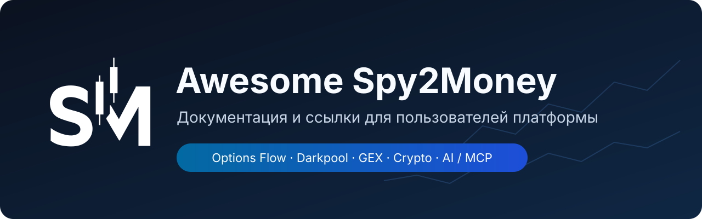

  

  
  
  

  <a href="https://app.spy2money.com/login"><strong>Открыть платформу</strong></a> ·
  <a href="https://app.spy2money.com/tariffs"><strong>Тарифы</strong></a> ·
  <a href="./docs/getting-started.md"><strong>Быстрый старт</strong></a> ·
  <a href="./docs/widgets/README.md"><strong>Справочник виджетов</strong></a> ·
  <a href="./docs/ai-and-mcp.md"><strong>AI и MCP</strong></a>

Курируемый список ссылок и пользовательская документация **[Spy2Money](https://spy2money.com)** — аналитической платформы для трейдеров рынка США и криптовалют: опционный поток (options flow), внебиржевые сделки (darkpool), гамма-экспозиция маркетмейкеров (GEX), уровни, скринеры, стратегии и AI-аналитика. Здесь собрано всё, что нужно пользователю: как начать, как читать каждый виджет, как подключить AI-агента и где получить помощь.

> [!NOTE]
> Spy2Money — инструмент анализа, а не инвестиционный советник. Все материалы носят образовательный характер и не являются индивидуальной инвестиционной рекомендацией. Торговля опционами и другими производными инструментами связана с высоким риском.

## Содержание

- [Быстрый старт](#быстрый-старт)
- [Официальные ресурсы](#официальные-ресурсы)
- [Рабочие разделы платформы](#рабочие-разделы-платформы)
- [Справочник виджетов](#справочник-виджетов)
- [AI-аналитика и MCP](#ai-аналитика-и-mcp)
- [Брокеры и портфель](#брокеры-и-портфель)
- [Доступ, оплата и уведомления](#доступ-оплата-и-уведомления)
- [Обучение и методология](#обучение-и-методология)
- [Внешние ресурсы по теме](#внешние-ресурсы-по-теме)
- [Сообщество и поддержка](#сообщество-и-поддержка)
- [Как помочь проекту](#как-помочь-проекту)

## Быстрый старт

1. **Зарегистрируйтесь** на [app.spy2money.com/login](https://app.spy2money.com/login) и подтвердите e-mail — без подтверждённой почты рабочее пространство не откроется.
2. **Откройте дашборд «Опционы»** — [/app/options](https://app.spy2money.com/app/options): рыночный поток, карты ордеров и сканер на одном экране.
3. **Найдите тикер** через поиск в шапке — откроется страница тикера с потоком, греками, уровнями GEX и ценой.
4. **Прочитайте справку** любой карточки: «…» в шапке виджета → «Справка», или страницу виджета в [справочнике](./docs/widgets/README.md).
5. **Оформите доступ** на [странице тарифов](https://app.spy2money.com/tariffs), чтобы получить данные в реальном времени.

Подробнее — [docs/getting-started.md](./docs/getting-started.md).

## Официальные ресурсы

- [Платформа Spy2Money](https://app.spy2money.com/login) — веб-приложение (работает и как PWA на телефоне).
- [spy2money.com](https://spy2money.com) — сайт проекта.
- [Тарифы и оплата](https://app.spy2money.com/tariffs) — периоды подписки и способы оплаты.
- [Политика и условия использования](https://app.spy2money.com/policy) — юридическая информация.
- [S2M Financial Portal](https://news.spy2money.com) — новости рынка, обучение, энциклопедия и аналитика управляющего.
- [MCP-сервер Spy2Money](./docs/ai-and-mcp.md) — `https://mcp.spy2money.com/mcp`, подключение данных платформы к Claude, Codex и другим AI-агентам.
- [@aivix_bot](https://t.me/aivix_bot) — официальный Telegram-бот: привязка аккаунта, оплата и уведомления.

## Рабочие разделы платформы

Подробное описание каждого раздела — [docs/dashboards.md](./docs/dashboards.md).

- [Опционы](https://app.spy2money.com/app/options) — главный дашборд: рыночный опционный поток, карты ордеров, сканер и топ тикеров по Net Premium.
- [Страница тикера](./docs/dashboards.md#страница-тикера) — поток, страйки, греки, GEX, IV, торговые идеи и цена одного инструмента.
- [Поток](https://app.spy2money.com/app/flow) — сравнение потока премии по нескольким тикерам.
- [Уровни](https://app.spy2money.com/app/levels) — расчётные уровни цены для наблюдения за удержанием и пробоем.
- [Darkpool](https://app.spy2money.com/app/darkpool) — внебиржевые сделки акций и ETF: карты, сканер принтов, графики по тикеру.
- [Скринер](https://app.spy2money.com/app/screener) — отбор тикеров по опционной активности с числовыми фильтрами.
- [Крипто](https://app.spy2money.com/app/crypto) — BTC/ETH: опционный поток, Gamma по страйкам, волатильность, интрадей и скринер топ-100 монет.
- [Стратегии](https://app.spy2money.com/app/strategies) — торговые стратегии, их статистика, сделки и подписки на сигналы.
- [AI Agent](https://app.spy2money.com/app/ai-agent) — чат-аналитик с доступом к данным платформы.
- [Собственные дашборды](./docs/dashboards.md#собственные-дашборды) — любая раскладка виджетов из каталога, личные размеры и порядок.
- [Ссылка на виджет](./docs/dashboards.md#ссылка-на-виджет) — один виджет на всю ширину по прямой ссылке.

## Справочник виджетов

Каждая страница описывает, что показывает виджет, как он считается, как его читать и где его ограничения. Общие правила — [Как читать данные Spy2Money](./docs/reading-data.md), термины — [глоссарий](./docs/glossary.md).

### Опционный поток рынка

- [Рыночный поток опционов](./docs/widgets/market-flow.md) — Сопоставляет поток опционов рынка или выбранного тикера с ценой. Помогает увидеть, когда меняется характер активности и насколько широко она распределена.
- [Market Netflow V2: премия опционного потока](./docs/widgets/market-netflow-v2.md) — Показывает рыночный поток CALL/PUT рядом с ценой SPY и позволяет сравнить новый рыночный индикатор потока (режим NEW) с исходным расчётом Market Netflow.
- [Market Net Flow Expiry](./docs/widgets/market-netflow-expiry.md) — Разделяет опционный поток по сроку экспирации и типу инструментов, чтобы краткосрочная активность не маскировала остальной рынок.
- [Топ тикеров по Net Premium](./docs/widgets/market-top-net-impact.md) — Помогает найти инструменты с заметным вкладом в чистую премию и перейти от общего рынка к конкретным тикерам.
- [Карты опционных ордеров](./docs/widgets/options-map.md) — Ранжируют тикеры по выбранной группе потока и показывают состав премии по сторонам исполнения.
- [Сканер опционного потока](./docs/widgets/options-order-flow.md) — Разбирает поток на отдельные исполнения/агрегаты и помогает проверить, какие контракты стоят за движением графиков.
- [Market Flow Alerts](./docs/widgets/market-flow-alerts.md) — Лента алертов необычной опционной активности по рынку: крупные sweep и floor сделки, объём выше открытого интереса, премия выше порога.
- [Секторные ETF](./docs/widgets/sector-flow.md) — Сравнивает опционный поток 11 секторных SPDR ETF (XLB, XLC, XLE, XLF, XLI, XLK, XLP, XLRE, XLU, XLV, XLY): где за день больше бычьей или медвежьей премии.
- [Лидеры по объёму](./docs/widgets/volume-leaders.md) — Компактные графики помогают быстро сравнить выбранные активные тикеры и перейти к подробному анализу.
- [Скринер настроений](./docs/widgets/sentiment-screener.md) — Сравнивает тикеры по агрегированным показателям опционной активности и помогает отобрать кандидатов для подробного анализа.

### Анализ тикера

- [Ticker Net Prem Realtime](./docs/widgets/ticker-net-prem.md) — Сопоставляет накопленные Call/Put премии и объём с ценой выбранного тикера за выбранный период.
- [Ticker Overview Strikes](./docs/widgets/ticker-overview-strikes.md) — Показывает, на каких страйках развивается net-премия, и помогает отличить общий поток от концентрации в отдельных уровнях.
- [Ticker Greek Flow](./docs/widgets/ticker-greek-flow.md) — Показывает поток чувствительностей Delta/Vega вместе с ценой, чтобы различать активность, связанную с направлением цены и с волатильностью.
- [Ticker Greek Spot Realtime](./docs/widgets/ticker-greek-spot.md) — Показывает модельную чувствительность опционной структуры к цене, времени и волатильности, включая распределение по страйкам и срокам.
- [Ticker GEX Levels](./docs/widgets/ticker-gex-levels.md) — Наносит ключевые уровни модельной гамма-экспозиции дилеров на цену торгового дня: где опционные позиции могут сдерживать или ускорять движение.
- [Ticker Gamma Profile](./docs/widgets/ticker-gamma-profile.md) — Совмещает минутные свечи с профилем модельной гамма-экспозиции по страйкам, чтобы видеть, где относительно цены сосредоточена Gamma и как она меняется в течение сессии.
- [Ticker IV Term Structure](./docs/widgets/ticker-iv-term-structure.md) — Показывает подразумеваемую волатильность ATM-опционов тикера по каждой реальной экспирации и её изменение с прошлой сессии: насколько дороги ближние опционы относительно дальних.
- [Ticker Trade Ideas](./docs/widgets/ticker-trade-ideas.md) — Объединяет волатильность, характеристики исполнения и опционные уровни для предварительного отбора идей.
- [Ticker Option Contract](./docs/widgets/ticker-option-contract.md) — Позволяет перейти от активных цепочек к конкретному контракту и изучить его торговлю внутри дня.
- [Ценовой график TradingView](./docs/widgets/ticker-tradingview.md) — Даёт ценовой контекст для опционного потока: тренд, диапазон, реакцию на уровни и события.
- [График уровней](./docs/widgets/level-chart.md) — Сопоставляет цену тикера с рассчитанными источником уровнями для наблюдения за удержанием, пробоем и возвратом.

### Позиционирование маркетмейкеров и стратегии

- [Влияние маркетмейкера SPX](./docs/widgets/spx-market-maker-impact.md) — Даёт модельную картину Gamma, Vanna и Charm около текущего SPX для оценки областей возможного изменения хеджирующей активности.
- [Strategy Builder](./docs/widgets/strategy-builder.md) — Моделирует опционную конструкцию из нескольких ног и показывает, как её результат зависит от цены, времени и волатильности.

### Darkpool (внебиржевые сделки)

- [Darkpool — карты денежного потока](./docs/widgets/darkpool-map.md) — Сравнивает внебиржевой денежный оборот акций и ETF за выбранный период и объясняет различие режима отбора и рейтинга.
- [Darkpool TOP BUY](./docs/widgets/market-darkpool-top-net-map-call.md) — Находит тикеры с покупательской долей не меньше 70% денежного оборота выбранных сторон и ранжирует их по обороту.
- [Darkpool TOP SELL](./docs/widgets/market-darkpool-top-net-map-put.md) — Находит тикеры с продавцовской долей не меньше 70% денежного оборота выбранных сторон и ранжирует их по обороту.
- [Darkpool TOP STOCKS](./docs/widgets/market-darkpool-top-net-map-stocks.md) — Сравнивает денежный оборот внебиржевых сделок акций и ADR по классификации инструмента источника.
- [Darkpool TOP ETF](./docs/widgets/market-darkpool-top-net-map-etf.md) — Сравнивает денежный оборот внебиржевых сделок ETF, кроме инструментов отдельного списка Short ETF источника.
- [Darkpool TOP SHORT ETF](./docs/widgets/market-darkpool-top-net-map-etf-short.md) — Показывает оборот инструментов из отдельного списка Short ETF источника, куда входят inverse/short и отдельные волатильностные фонды.
- [Сканер darkpool потока — отдельные принты](./docs/widgets/market-darkpool-flow.md) — Показывает отдельные внебиржевые исполнения акций и ETF и позволяет проверить сделки, из которых формируются карты и график по тикеру.
- [Ticker Darkpool Net Prem — график по тикеру](./docs/widgets/ticker-darkpool-net-prem.md) — Показывает внебиржевые исполнения выбранной акции или ETF по временным интервалам: цену, денежный оборот сторон и накопительную разность объёмов акций.

### Криптовалюты

- [Крипторынок BTC / ETH](./docs/widgets/crypto-market.md) — Объединяет цену монеты и состояние волатильности опционного рынка для выбранного BTC или ETH.
- [Барометр волатильности BTC / ETH](./docs/widgets/crypto-radar.md) — Сравнивает волатильностный режим BTC и ETH на одном экране.
- [Крипто Gamma по страйкам](./docs/widgets/crypto-gex.md) — Показывает распределение модельной Gamma-экспозиции BTC/ETH и отмеченные уровни вокруг текущей цены.
- [Крипто опционный поток](./docs/widgets/crypto-flow.md) — Показывает активность опционов BTC/ETH, денежный размер CALL/PUT и развитие знаковой премии.
- [Крипто терм-структура IV](./docs/widgets/crypto-volatility.md) — Сравнивает ожидаемую волатильность BTC/ETH по срокам и недавнюю реализованную волатильность.
- [Crypto Intraday](./docs/widgets/crypto-intraday.md) — Сопоставляет цену perpetual BTC/ETH с текущим профилем модельной Gamma по страйкам и ключевыми уровнями на истории цены до семи дней.
- [Ценовой график криптовалюты Vela](./docs/widgets/crypto-vela-price.md) — Показывает спотовую цену выбранной монеты на указанной бирже. Интервал, вид графика, инструменты рисования и встроенные индикаторы доступны в Vela.
- [Скринер криптовалют](./docs/widgets/crypto-coin-screener.md) — Сравнивает монеты по рыночным данным TradingView в долларах США и позволяет отобрать монету по названию или тикеру.

### Новости

- [Financial News](./docs/widgets/financial-news.md) — Показывает ленту новостей для сопоставления событий с движением цены, волатильности и потока.

## AI-аналитика и MCP

- [AI Agent в приложении](./docs/ai-and-mcp.md#ai-agent-в-приложении) — анализ тикеров и рынка на естественном языке по данным платформы.
- [AI в Strategy Builder](./docs/ai-and-mcp.md#ai-в-strategy-builder) — подбор опционной конструкции под направление, срок и допустимый убыток.
- [MCP-сервер](./docs/ai-and-mcp.md#mcp-сервер-spy2money) — подключение данных Spy2Money к Claude, Claude Code, Codex: только чтение, OAuth, отзыв доступа в профиле.
- [Каталог MCP-инструментов](./docs/ai-and-mcp.md#инструменты) — анализ тикера, поток, darkpool, греки, GEX, IV, крипто-опционы, новости, ваши дашборды и подписки.
- [Model Context Protocol](https://modelcontextprotocol.io/) — открытый стандарт подключения инструментов к AI-ассистентам.

## Брокеры и портфель

- [Интеграции](./docs/brokers.md) — подключение Freedom24 / Tradernet и Bybit, портфель, остатки и позиции на одной странице.
- [Безопасность ключей](./docs/brokers.md#безопасность) — ключи хранятся только на сервере в зашифрованном виде; торговля по умолчанию выключена.

## Доступ, оплата и уведомления

- [Доступ и тарифы](./docs/access-and-billing.md) — что доступно без подписки, что даёт полный доступ.
- [Способы оплаты](./docs/access-and-billing.md#оплата) — карта через Tribute в Telegram или USDT.
- [Привязка Telegram](./docs/access-and-billing.md#привязка-telegram) — нужна для оплаты через Tribute и Telegram-уведомлений.
- [Уведомления](./docs/access-and-billing.md#уведомления) — push в браузере и приложении, сообщения в Telegram, алерты по метрикам виджетов и darkpool.
- [FAQ](./docs/faq.md) — частые вопросы о данных, доступе и оплате.

## Обучение и методология

- [Как читать данные Spy2Money](./docs/reading-data.md) — общие правила: свежесть, пустые состояния, единицы, ограничения выводов.
- [Глоссарий](./docs/glossary.md) — Net Premium, ASK/BID, sweep, DTE, GEX, Vanna, Charm, IV, darkpool и другие термины.
- [Я новичок](https://news.spy2money.com/start) — маршрут для начинающих на S2M Financial Portal.
- [Обучение трейдингу](https://news.spy2money.com/education) — учебные материалы портала.
- [Энциклопедия трейдера](https://news.spy2money.com/encyclopedia) — справочник терминов и понятий.
- [Методики анализа рынка](https://news.spy2money.com/methodologies) — технический, фундаментальный и опционный анализ.
- [Торговые стратегии S2M](https://news.spy2money.com/strategies) — разбор стратегий.
- [Опционы на криптовалюты](https://news.spy2money.com/crypto-options) — основы крипто-опционов.
- [Индикаторы TradingView](https://news.spy2money.com/indikatory) — разбор встроенных индикаторов.
- [Аналитика управляющего](https://news.spy2money.com/manager-analytics) — ежедневный разбор рынка и прогнозы.
- [Экономический календарь](https://news.spy2money.com/calendar) — события, влияющие на рынок.
- [YouTube Spy2Money](https://www.youtube.com/@spy2money) — видеоразборы платформы и рынка.

## Внешние ресурсы по теме

Независимые материалы, которые помогают понимать данные платформы.

### Опционы

- [Options Industry Council](https://www.optionseducation.org/) — бесплатный учебный центр OCC по опционам.
- [Cboe Options Institute](https://www.cboe.com/education/) — курсы и материалы биржи Cboe.
- [Cboe Market Statistics](https://www.cboe.com/us/options/market_statistics/) — объёмы и put/call ratio по рынку опционов США.
- [Cboe VIX](https://www.cboe.com/tradable_products/vix/) — индекс ожидаемой волатильности S&P 500.
- [Investopedia: греки опционов](https://www.investopedia.com/trading/getting-to-know-the-greeks/) — Delta, Gamma, Vega, Theta.
- [Investopedia: Gamma](https://www.investopedia.com/terms/g/gamma.asp) — что такое гамма и почему она важна для хеджа.
- [Investopedia: Implied Volatility](https://www.investopedia.com/terms/i/iv.asp) — подразумеваемая волатильность.
- [Investopedia: Open Interest](https://www.investopedia.com/terms/o/open-interest.asp) — открытый интерес.

### Darkpool

- [FINRA OTC Transparency](https://otctransparency.finra.org/otctransparency/) — официальная статистика внебиржевых торгов и ATS.
- [Investopedia: Dark Pool](https://www.investopedia.com/terms/d/dark-pool.asp) — что такое тёмные пулы.

### Криптовалюты и графики

- [Deribit](https://www.deribit.com/) — крупнейшая площадка опционов на BTC и ETH.
- [TradingView](https://www.tradingview.com/) — графики, используемые в ценовых виджетах.

### AI-агенты

- [Model Context Protocol](https://modelcontextprotocol.io/) — спецификация MCP.
- [Custom connectors в Claude](https://support.claude.com/en/articles/11175166-getting-started-with-custom-connectors-using-remote-mcp) — как добавить удалённый MCP-сервер.
- [MCP в Claude Code](https://docs.claude.com/en/docs/claude-code/mcp) — подключение MCP-серверов в CLI.
- [MCP в Codex](https://developers.openai.com/codex/mcp) — подключение MCP-серверов в Codex.

### Связанные списки

- [awesome](https://github.com/sindresorhus/awesome) — каталог awesome-списков.
- [awesome-quant](https://github.com/KonstantinRogozhkin/awesome-quant) — библиотеки и ресурсы для количественных финансов.
- [awesome-systematic-trading](https://github.com/KonstantinRogozhkin/awesome-systematic-trading) — системная торговля.
- [awesome-quant-competitions](https://github.com/KonstantinRogozhkin/awesome-quant-competitions) — соревнования по квант-трейдингу.

## Сообщество и поддержка

- [Telegram-канал Spy2Money](https://t.me/spy2money) — новости проекта и разборы рынка.
- [Чат трейдеров](https://t.me/spy2moneychat) — общение с пользователями.
- [@aivix_bot](https://t.me/aivix_bot) — бот платформы: привязка Telegram, оплата, уведомления.
- [Issues этого репозитория](https://github.com/KonstantinRogozhkin/awesome-spy2money/issues) — ошибки в документации и предложения.

## Как помочь проекту

Нашли неточность или хотите добавить полезную ссылку? Прочитайте [CONTRIBUTING.md](./CONTRIBUTING.md) и откройте Pull Request.

## Лицензия

Текст этого репозитория передан в общественное достояние по [CC0 1.0](./LICENSE). Товарные знаки, логотип Spy2Money и данные платформы принадлежат их владельцам.
